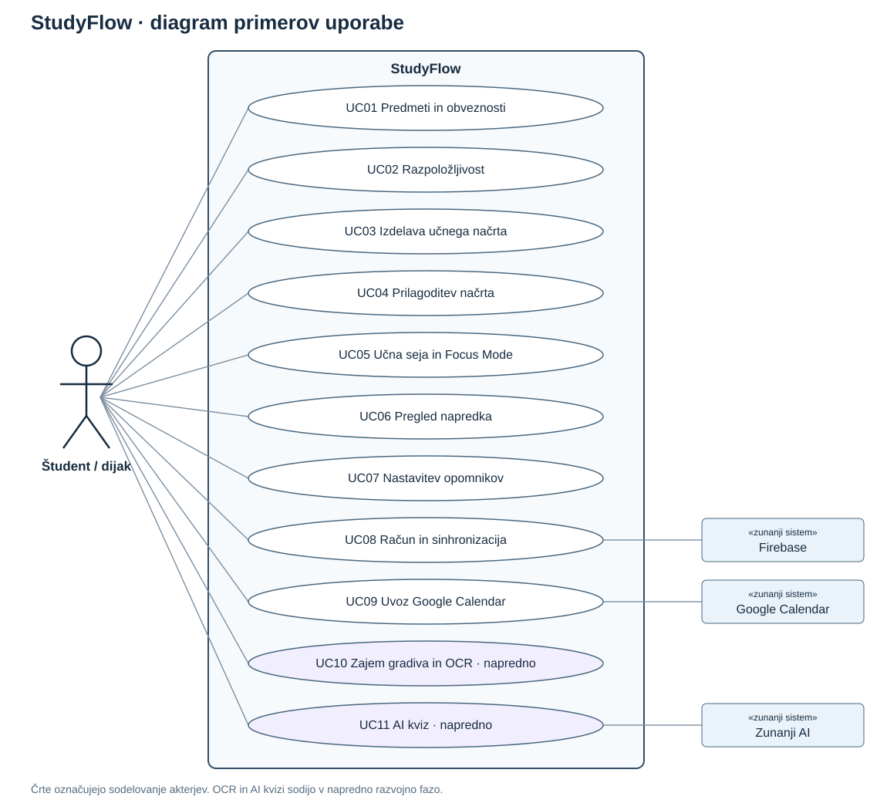
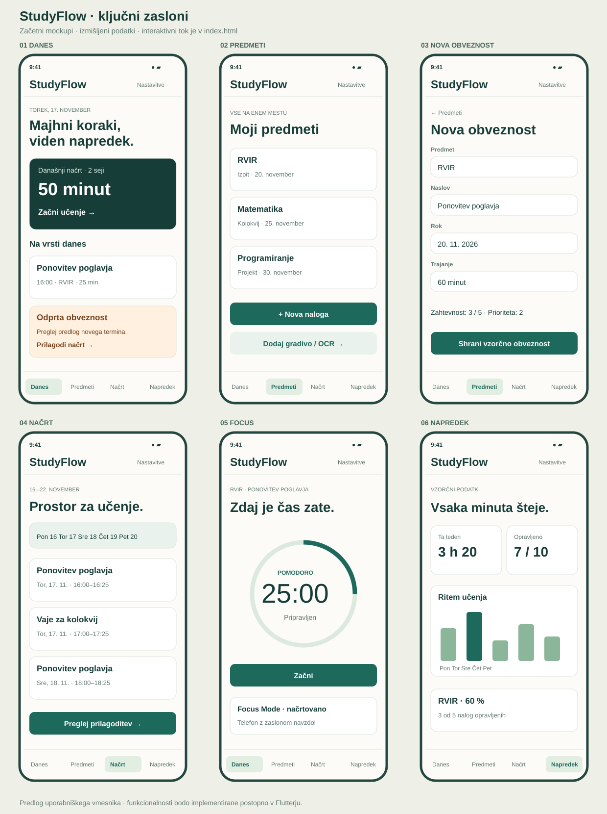

# StudyFlow

**Inteligentni načrtovalnik učenja** je načrtovana mobilna aplikacija za študente in dijake. Pomagala bo organizirati predmete, obveznosti in čas ter prilagoditi učni načrt dejanskemu napredku.

Projekt pri predmetu **Razvoj vseprisotnih informacijskih rešitev (RVIR)**, študijsko leto **2026/2027**.

## Trenutno stanje

Smo v fazi **načrtovanja in prototipne dokumentacije**. Pripravljeni so dokumentacija, diagrami, mockupi, osnovne Flutter mape in začetni CI za preverjanje dokumentacije. Flutter aplikacija še ni implementirana; mape so priprava za nadaljnje delo.

Javni GitHub repozitorij bo uporabnik objavil sam. Vabila ekipi in asistentu, objavo Issues ter osebno razdelitev odgovornosti dopolnimo pozneje, pred oddajo. Uspešen zagon GitHub Actions preverimo po prvem pushu.

## Ekipa

- Nađa Tomović
- Ljupka Koteska
- Petar Kolev

Naloge bomo razdelili skupaj; predlagana področja so v [načrtu dela](dokumentacija/05-organizacija-dela.md).

## Kaj bo omogočala aplikacija

1. Upravljanje predmetov, izpitov, kolokvijev in učnih nalog.
2. Dnevni in tedenski učni načrt ter prilagajanje ob zamudah.
3. Pomodoro, Focus Mode z akcelerometrom in lokalne opomnike.
4. Pregled napredka in statistike.
5. Račune in sinhronizacijo s Firebase ter uvoz dogodkov iz Google Calendar.
6. OCR gradiva z oceno časa in, kot napredno funkcijo, AI kvize.

Načrtovane tehnologije: **Flutter/Dart, SQLite, Firebase Authentication, Cloud Firestore, Google Calendar API**, paketi za senzorje, obvestila, kamero, OCR in grafikone. Končne izbire in odprta vprašanja so v [arhitekturi](dokumentacija/04-arhitektura.md).

## Dokumentacija

| Vsebina | Povezava |
| --- | --- |
| Zahteve oddaje in trenutno stanje | [Kontrolni seznam](dokumentacija/00-nacrt-oddaje.md) |
| Opis in funkcionalne zahteve | [Zasnova](dokumentacija/01-opis-projekta.md) |
| DPU in ključni uporabniški scenariji | [Primeri uporabe](dokumentacija/02-uporabniski-scenariji.md) |
| Začetni podatkovni model in ER diagram | [Podatkovni model](dokumentacija/03-podatkovni-model.md) |
| Arhitektura in tehnologije | [Arhitektura](dokumentacija/04-arhitektura.md) |
| Faze in odgovornosti | [Organizacija dela](dokumentacija/05-organizacija-dela.md) |
| Mockupi in navigacija | [Prototip](dokumentacija/06-prototip.md) |
| Pripravljene naloge za poznejšo objavo | [Osnutki Issues](dokumentacija/07-zacetne-naloge.md) |
| Objava in začetni CI | [GitHub navodila](dokumentacija/08-github-in-ci.md) |

## Predogled





Za interaktivni ogled odprite [dokumentacija/mockupi/index.html](dokumentacija/mockupi/index.html) **lokalno v brskalniku**. Dodatne namestitve niso potrebne. GitHub HTML prikazuje kot izvorno datoteko. Prototip uporablja izmišljene podatke; prijava in zunanje storitve niso povezane.

## Struktura

```text
StudyFlow/
├── lib/
│   ├── screens/     # Zasloni aplikacije
│   ├── models/      # Podatkovni modeli
│   ├── services/    # Shranjevanje, načrtovanje in integracije
│   ├── providers/   # Upravljanje stanja; izbiro knjižnice še potrdimo
│   └── widgets/     # Komponente, ki se ponavljajo na zaslonih
├── assets/          # Slike in druge statične datoteke
├── test/            # Prihodnji testi Flutter aplikacije
├── dokumentacija/   # Zasnova, diagrami, mockupi in načrt dela
├── scripts/         # Začetno preverjanje dokumentacije
└── .github/         # GitHub Actions in predloga naloge
```

Prazne mape imajo `.gitkeep`, da jih Git shrani. Datoteke `.dart`, `pubspec.yaml` in platformne mape dodamo ob dejanski inicializaciji Flutter projekta. Kratka navodila so v [lib/README.md](lib/README.md).

## Preverjanje

Za preverjanje potrebujete Python 3.12 ali novejši, brez dodatnih paketov:

```sh
python scripts/check_project.py
```

Enak ukaz zažene GitHub Actions ob pushu, pull requestu ali ročnem zagonu. Preverja datoteke, lokalne povezave, SVG in navigacijo prototipa. Flutter preverjanja dodamo skupaj z aplikacijo.

## Dopolnjevanje README

Ob vsaki zaključeni fazi posodobimo stanje in povezave. Ob začetku razvoja dodamo preverjeno različico Flutter SDK, ukaze za zagon in testiranje ter konfiguracijo storitev. Po objavi dodamo povezavo do repozitorija in uspešnega CI. Skrivnosti in osebni podatki ne sodijo v javni repozitorij.

Vsebinsko izhodišče: posredovani dokument `OpisProjekta(3).docx`, »Predlog projektne naloge – StudyFlow«.
