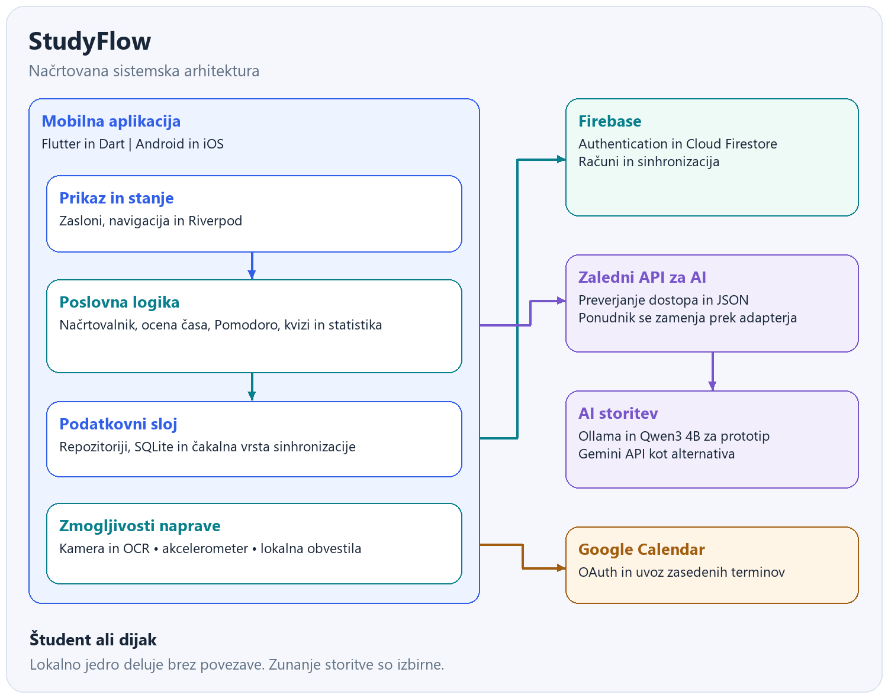

# StudyFlow

**Inteligentni načrtovalnik učenja za študente in dijake.**

StudyFlow je načrtovana mobilna aplikacija, ki poveže predmete, izpite, naloge in učno gradivo v prilagodljiv dnevni ali tedenski načrt. Pri razporejanju upošteva roke, razpoložljivi čas in dejanski napredek uporabnika.

## Načrtovane funkcionalnosti

- Upravljanje predmetov, nalog, izpitov in rokov.
- Samodejni predlog učnih sej ter prilagoditev načrta ob zamudah.
- Pomodoro časovnik in spremljanje aktivnega časa učenja.
- Pregled napredka in rezultatov kvizov.
- Načrtovane nadgradnje: lokalna obvestila, Firebase računi in sinhronizacija, Google Calendar, zajem gradiva z OCR ter AI kvizi.
- Izbirni preizkus Focus Mode z akcelerometrom.

## Načrtovane tehnologije

| Sklop | Tehnologije |
| --- | --- |
| Mobilna aplikacija | Flutter, Dart; Android in iOS |
| Stanje in lokalni podatki | Riverpod kot predlog, SQLite |
| Računi in sinhronizacija | Firebase Authentication, Cloud Firestore |
| Koledar in obvestila | Google Calendar API, flutter_local_notifications |
| Senzor, zajem in grafi | sensors_plus, image_picker, Google ML Kit Text Recognition, fl_chart |
| AI | Ločen zaledni API; Ollama in Qwen3 4B za prototip, Gemini API kot alternativa |

## Arhitektura



Mobilni prikaz, poslovna logika in podatkovni repozitoriji so ločeni. Lokalni načrtovalnik in SQLite omogočata osnovno uporabo brez povezave. Firebase podpira izbirno sinhronizacijo, AI zahteve pa potujejo prek zalednega API, kjer ostanejo ključi ponudnika. Koledar, OCR in senzor so povezani prek ločenih adapterjev.

## Dokumentacija in stanje

[Projektna dokumentacija v Wordu](Dokumentacija/StudyFlow_Podrobna_dokumentacija.docx) opisuje funkcionalnosti, mobilne zaslone, podatkovni model in arhitekturo.

Projekt ima prazno Flutter/Dart osnovo. Ob zagonu se prikaže prazen zaslon. Funkcionalnosti, navigacija, podatkovna baza in zunanje storitve še niso implementirane. Navedene funkcionalnosti in tehnologije opisujejo načrtovano rešitev.

### Začetna struktura

```text
StudyFlow/
├── .github/workflows/ci.yml  # Začetna preverjanja
├── android/                 # Osnova za Android
├── ios/                     # Osnova za iOS
├── lib/
│   ├── main.dart            # Vstopna točka s praznim zaslonom
│   ├── models/              # Prostor za podatkovne modele
│   ├── providers/           # Prostor za upravljanje stanja
│   ├── screens/             # Prostor za zaslone
│   ├── services/            # Prostor za dostop do podatkov in storitev
│   └── widgets/             # Prostor za skupne gradnike
├── assets/                  # Prostor za sredstva aplikacije
├── test/app_test.dart       # Preverjanje zagona prazne aplikacije
├── Dokumentacija/           # Word dokument, diagrami in zasnove
├── DPU/                     # Diagram primerov uporabe
├── analysis_options.yaml    # Osnovna pravila analize
└── pubspec.yaml             # Konfiguracija Flutter/Dart projekta
```

Prazne mape so v Git vključene z datotekami `.gitkeep`. Dodatne knjižnice za načrtovane funkcionalnosti bomo dodali ob začetku njihove izvedbe.

### Lokalni zagon

Uporabljamo Flutter **3.47.7 stable**, ki vključuje Dart **3.13.5**. Za Android potrebujemo Android SDK in emulator ali povezano napravo. Za gradnjo in zagon iOS potrebujemo macOS in Xcode.

V korenski mapi projekta:

```sh
flutter pub get --enforce-lockfile
flutter run
```

### Začetna preverjanja

```sh
dart format --output=none --set-exit-if-changed lib test
flutter analyze --no-pub
flutter test --no-pub
```

Workflow [StudyFlow CI](.github/workflows/ci.yml) izvede ista preverjanja ob `push`, `pull_request` ali ročnem zagonu. Na tej stopnji preverja samo prazno osnovo aplikacije.

### Organizacija dela

Repozitorij, organizacija ter dostop članov ekipe in asistenta so že urejeni. GitHub Issues, prioritete in konkretno razdelitev odgovornosti bomo skupaj določili pozneje. Predvideno zaporedje razvoja je opisano v Word dokumentaciji.

**Ekipa:** Nađa Tomović, Ljupka Koteska, Petar Kolev

**Predmet:** Razvoj vseprisotnih informacijskih rešitev (RVIR), 2026/2027
