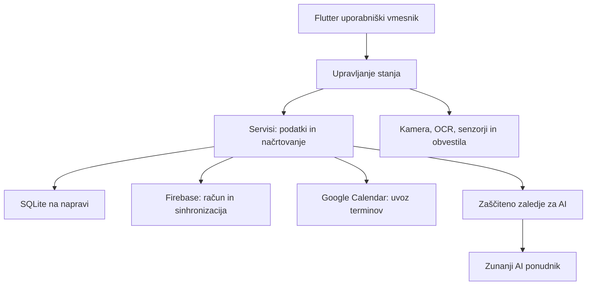

# Tehnična zasnova

## Tehnologije

Flutter in Dart za Android in iOS; SQLite za lokalne podatke; Firebase Authentication in Cloud Firestore za račune in sinhronizacijo; Google Calendar API za uvoz dogodkov. Za napravo so predvideni sensors_plus, flutter_local_notifications in image_picker; za OCR Google ML Kit Text Recognition, za grafe fl_chart. Riverpod ali Provider in ponudnika AI še izberemo.

V začetni kodi uporabljamo samo Flutter. Pakete in konfiguracije drugih storitev bomo dodali ob razvoju posamezne funkcije.

## Začetna arhitektura

Načrtovalnik bo lokalna logika, ločena od zaslonov. Razporedil bo preostalo delo pred roki, znotraj prostih terminov in brez prekrivanj. Če časa zmanjka, bo prikazal nerazporejene minute. Novi načrt se shrani po potrditvi uporabnika.

## Začetni podatkovni model

| Entiteta | Glavna polja |
| --- | --- |
| UserProfile | id, firebaseUid?, displayName, timeZone |
| Subject | id, userId, name, color |
| Task | id, subjectId, title, type, deadlineUtc, estimatedMinutes, remainingMinutes, difficulty, priority, status |
| Availability | id, userId, weekday?, date?, startLocal, endLocal, isAvailable |
| StudyPlan | id, userId, periodStart, periodEnd, version, status |
| StudySession | id, taskId, planId?, startUtc, endUtc, actualMinutes, status |
| CalendarEvent | id, userId, calendarId, externalId, startUtc, endUtc |
| Reminder | id, taskId?, sessionId?, scheduledUtc, enabled |
| StudyMaterial | id, taskId, recognizedText, estimatedMinutes, localImagePath? |
| Quiz | id, materialId, generatedAt, title |
| QuizQuestion | id, quizId, prompt, options, correctIndex, explanation |

`?` označuje neobvezno polje. Uporabnik ima predmete, razpoložljivost, načrte in koledarske dogodke. Predmet ima naloge, naloga seje in gradiva, gradivo kvize, kviz pa vprašanja. Seja je lahko neposredno začeta brez načrta. Opomnik pripada nalogi ali seji, vedno natanko eni od njiju.

## Pravila in odprte odločitve

- Trajanje je v minutah; časovni trenutki v UTC, razpoložljivost v uporabnikovem časovnem pasu. Zahtevnost je 1–5, prioriteta 1–3; 1 je najvišja prioriteta.
- Uvoz koledarja posodobi isti zunanji identifikator in ne podvoji dogodka. Začetni obseg ne vključuje pisanja v Google Calendar.
- Predlog sinhronizacije: lokalno branje iz SQLite, pošiljanje sprememb v Firestore, oznake izbrisa in pregled konfliktov. Računi imajo ločene podatke.
- Žetoni sodijo v varno shrambo naprave; AI ključ ostane na zaledju. Pravila Firestore preverimo pred uporabo resničnih podatkov.
- Pred implementacijo potrdimo knjižnico SQLite, upravljanje stanja, sinhronizacijski protokol in različice paketov.
