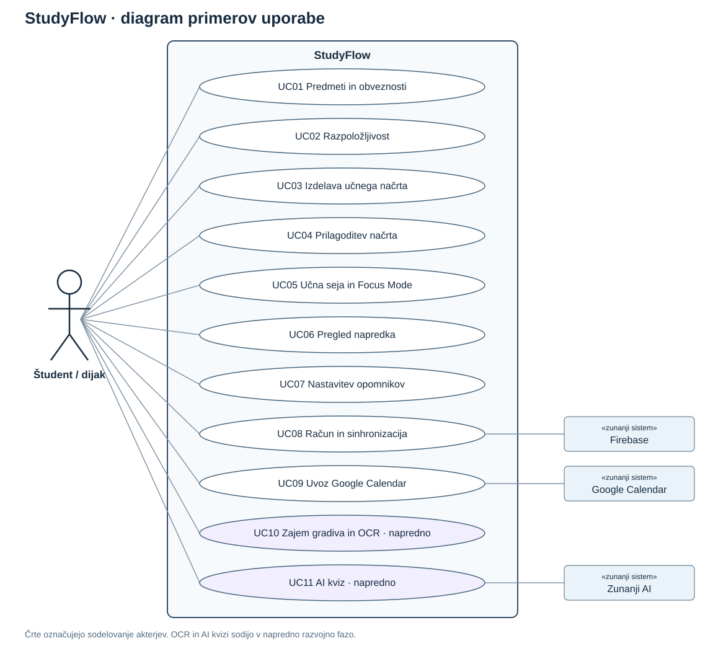

# DPU in uporabniški scenariji

## Diagram primerov uporabe

Primarni akter je študent oziroma dijak. Podporni sistemi so Firebase, Google Calendar in zunanji AI. Kamera, senzorji in SQLite so del izvedbe aplikacije, ne ločeni uporabniki. Povezave pomenijo sodelovanje pri primeru uporabe, ne zaporedja korakov.

SVG je neposredno berljiv v repozitoriju. Za nadaljnje urejanje je dodan tudi [izvor PlantUML](diagrami/primeri-uporabe.puml). Napredne funkcionalnosti so posebej označene.

## Ključni scenariji

| ID in cilj | Predpogoj | Osnovni tok | Rezultat in izjeme | Zahteve |
| --- | --- | --- | --- | --- |
| UC01 Upravljanje predmetov in obveznosti | Odprta aplikacija, tudi brez računa | Uporabnik ustvari predmet; doda nalogo, izpit ali kolokvij; vnese rok, zahtevnost, trajanje in prioriteto; shrani. | Podatki so shranjeni lokalno. Napačen vnos se ohrani z razlago; brisanje zahteva potrditev in pojasni posledice za povezane podatke. | F01–F02 |
| UC02 Določitev razpoložljivosti | Znani prosti termini uporabnika | V nastavitvah izbere dneve in intervale; doda datumske izjeme; shrani. | Načrtovalnik uporablja te termine. Neveljavni in prekrivajoči se intervali zahtevajo popravek. | F03 |
| UC03 Izdelava načrta | Vsaj ena obveznost in razpoložljivost | Na zaslonu Načrt zahteva predlog; pregleda seje in opozorila; potrdi. | Potrjeni načrt je shranjen. Ob premalo časa se izpiše nerazporejeno delo; rok se ne premakne samodejno. | F04 |
| UC04 Prilagoditev načrta | Obstoječi načrt in zamuda ali spremenjeno trajanje | Označi zamudo; sistem predlaga nove prihodnje termine; uporabnik primerja in potrdi ali zavrne. | Potrditev posodobi prihodnje seje in opomnike. Zavrnitev ohrani stari načrt. Pretekle opravljene seje se ne spreminjajo. | F05 |
| UC05 Učna seja in Focus Mode | Izbrana naloga | Začne Pomodoro; po potrebi ustavi; lahko vključi Focus Mode; zaključi sejo in ločeno označi dokončanost naloge. | Shrani se dejanski čas. Senzor deluje med aktivno uporabo; če ni dostopen, ostane ročni način. Sistem ne obljublja blokiranja drugih aplikacij. | F06, F09 |
| UC06 Pregled napredka | Odprt zaslon Napredek | Izbere obdobje in pregleda minute, dokončane naloge ter napredek po predmetih. | Prikaz temelji na shranjenih podatkih. Brez sej se prikaže začetno stanje. | F07 |
| UC07 Nastavitev opomnikov | Obveznost ali načrtovana seja | Vključi opomnike; po potrebi dovoli obvestila; izbere čas. | Sistem načrtuje obvestila in jih ob spremembah posodobi. Zavrnitev dovoljenja ne blokira načrtovanja. | F08 |
| UC08 Račun in sinhronizacija | Internet za prijavo | Ustvari račun ali se prijavi; potrdi povezavo lokalnih podatkov z računom; aplikacija sinhronizira. | Podatki so ločeni po računih. Brez interneta se spremembe shranijo lokalno; ob menjavi računa se podatki ne združijo samodejno. | F10 |
| UC09 Uvoz Google Calendar | Internet in soglasje uporabnika | Poveže koledar; izbere koledarje; uvozi zasedene termine; zahteva nov predlog načrta. | Načrt upošteva zasedenost. Ponovni uvoz ne podvoji dogodkov; ob napaki je mogoč ročni vnos. Pisanje v Google Calendar ni del začetnega načrta. | F11 |
| UC10 Zajem gradiva in OCR | Kamera ali izbrana slika | Zajame gradivo; pregleda in popravi besedilo; prilagodi oceno časa; poveže z nalogo. | Potrjeno gradivo se uporabi pri načrtovanju. Slabo prepoznavanje, rokopis ali nepodprt jezik imajo možnost ročnega vnosa. | F12, napredno |
| UC11 AI kviz | Besedilo, internet in potrditev pošiljanja | Izbere besedilo; potrdi zahtevo; odgovori na vprašanja; pregleda razlago. | Zaledje preveri odgovor AI. Napake ali omejitve omogočijo ponovni poskus; AI odgovor ni zagotovilo pravilnosti. | F13, napredno |

## Primer osrednjega toka

Študent doda predmet RVIR in nalogo »Ponovitev poglavja«, ocenjeno na 60 minut, z rokom v petek. Za učenje ima na voljo 30 minut v sredo in četrtek. Sistem predlaga dve seji. Če sredino sejo izpusti, predlaga nov prost termin pred petkovim rokom. Če ga ni, jasno pokaže 30 minut nerazporejenega dela. Uporabnik sam odloči, ali bo povečal razpoložljivost ali prilagodil obveznost.
