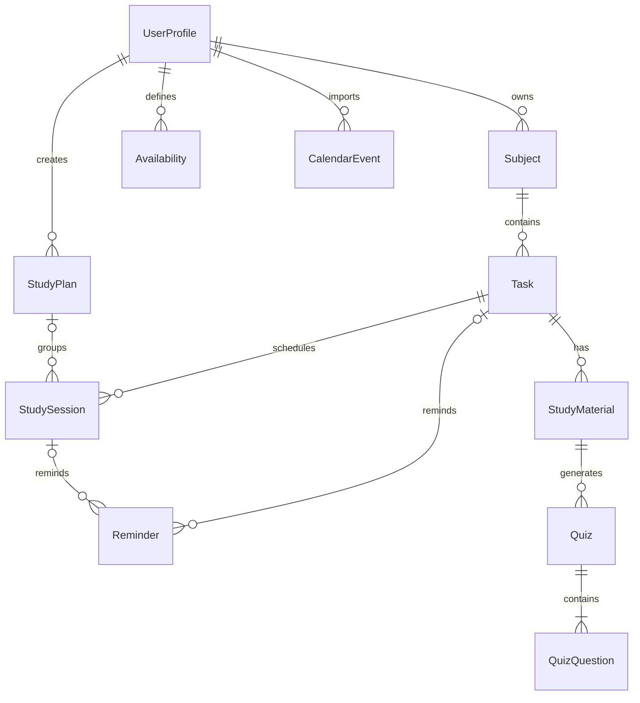

# Začetni podatkovni model

To je konceptualni model za prihodnjo implementacijo. SQL shema in struktura Firestore še nista izdelani. Podatki, potrebni za lokalno delo, so najprej v SQLite; sinhronizacija je naslednja razvojna faza.

## Entitete

| Entiteta | Pomembna polja | Namen |
| --- | --- | --- |
| UserProfile | id, firebaseUid?, displayName, timeZone | Lokalni uporabnik; povezava z računom je neobvezna. |
| Subject | id, userId, name, color | Predmet in lastnik. |
| Task | id, subjectId, title, type, deadlineUtc, estimatedMinutes, remainingMinutes, difficulty, priority, status | Naloga, izpit ali kolokvij; preostali čas je prilagodljiva ocena. |
| Availability | id, userId, weekday?, date?, startLocal, endLocal, isAvailable | Tedenski termin ali datumska izjema v uporabnikovem časovnem pasu. |
| StudyPlan | id, userId, periodStart, periodEnd, status, version | Osnutek ali potrjen načrt za obdobje. |
| StudySession | id, planId?, taskId, startUtc, endUtc, actualMinutes, status | Načrtovana ali neposredno začeta učna seja. |
| CalendarEvent | id, userId, calendarId, externalId, startUtc, endUtc, importedAt | Uvožen zaseden termin. |
| Reminder | id, taskId?, sessionId?, scheduledUtc, enabled, deviceNotificationId? | Opomnik naloge ali seje na napravi. |
| StudyMaterial | id, taskId, sourceType, localImagePath?, recognizedText, estimatedMinutes | Ročno ali z OCR vneseno gradivo; napredna faza. |
| Quiz | id, materialId, generatedAt, title | Kviz iz gradiva; napredna faza. |
| QuizQuestion | id, quizId, prompt, optionsJson, correctIndex, explanation | Vprašanje in odgovor za samopreverjanje. |

`?` pomeni neobvezno polje. Sinhronizirane entitete bodo imele še `updatedAt`, `deletedAt?` in različico za zaznavanje konfliktov. To so metapodatki, ne nova uporabniška funkcija.

## ER diagram

Diagram prikazuje povezave; polja so v zgornji tabeli. Opomnik ima natanko eno povezavo: na nalogo **ali** na sejo. Seja lahko obstaja brez načrta, če jo uporabnik začne neposredno.

## Pravila podatkov

- Identifikatorji nastanejo lokalno in ostanejo enaki ob sinhronizaciji. Lastnika naloge določimo prek njenega predmeta.
- `type`: task, exam ali colloquium; `status` naloge: todo, inProgress ali done. Prioriteta 1 je najvišja, 3 najnižja.
- `difficulty` je 1–5, `estimatedMinutes` > 0 in `remainingMinutes` ≥ 0. Dejanski čas seje sam po sebi ne pomeni dokončane naloge.
- Konec časovnega intervala je za začetkom. Potrjene prihodnje seje istega uporabnika se ne smejo prekrivati ali posegati v zasedene termine.
- Za eno obdobje je aktivna ena potrjena različica načrta; stare različice ohranijo zgodovino. Ob potrditvi novega predloga ne podvojimo že opravljenih sej.
- Par `calendarId` in `externalId` je enoličen znotraj uporabnika. Celodnevni dogodki se pretvorijo glede na časovni pas koledarja.
- Prepoznavno besedilo se lahko popravi. Slike so sprva lokalne in se ne nalagajo v oblak brez izrecne odločitve uporabnika.
- Statistika se izračuna iz nalog in dejanskega časa zaključenih sej; ne podvajamo je v samostojni tabeli.
- Brisanje predmeta zahteva potrditev vpliva na naloge in zgodovino. Za prihodnjo sinhronizacijo uporabljamo oznako izbrisa, da se izbrisani podatki ne pojavijo znova.
- Posamezen uporabnik lahko bere in spreminja samo svoje podatke. Žetoni in gesla niso del teh tabel.

## Odprto pred implementacijo

Potrdimo natančne SQL tipe, migracije, indekse, obravnavo ponavljajočih se koledarskih dogodkov ter hrambo kvizov. Preizkusimo datumske izjeme razpoložljivosti in prehod na poletni čas.
