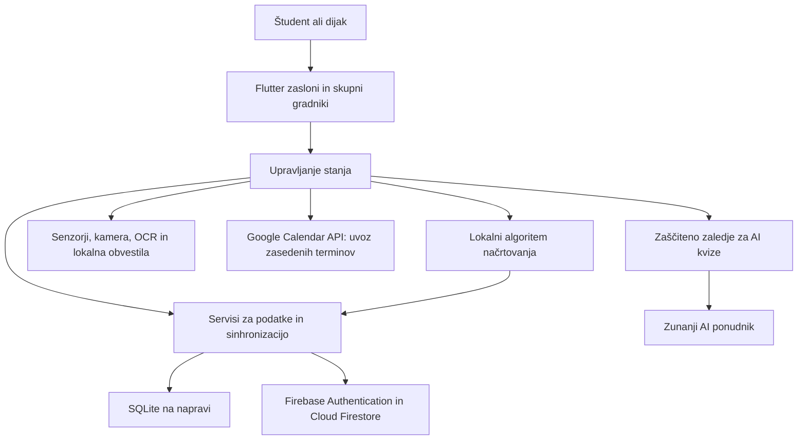

# Začetna arhitektura in tehnologije

## Preprosta razdelitev

Zaslon prikazuje podatke, upravljanje stanja poveže uporabnikova dejanja s servisi, servisi pa izvajajo shranjevanje, načrtovanje in integracije. Podatkovni modeli opisujejo predmete, naloge in učne seje. V tej fazi pripravljamo mape; spodnja arhitektura je načrt.

## Načrtovane tehnologije

| Tehnologija | Uporaba | Odločitev |
| --- | --- | --- |
| Flutter in Dart | Android in iOS aplikacija | Predvideno v izhodiščnem dokumentu; SDK določimo ob inicializaciji. |
| SQLite | Lokalno shranjevanje | Predvideno; knjižnico in migracije izberemo pred razvojem. |
| Firebase Authentication, Cloud Firestore | Računi in sinhronizacija | Predvideno; konfiguracija in varnostna pravila še sledijo. |
| Google Calendar API | Uvoz koledarskih dogodkov | Predvideno; začetni tok je branje, ne izvoz načrta v koledar. |
| sensors_plus | Akcelerometer in položaj naprave | Predvideno; preverjanje na fizični napravi. |
| flutter_local_notifications | Lokalni opomniki | Predvideno; dovoljenja in vedenje preverimo po platformah. |
| image_picker, Google ML Kit Text Recognition | Zajem slike in OCR | Predvideno; podpora izbranim jezikom in rokopisu je predmet preverjanja. |
| fl_chart | Grafi napredka | Predvideno. |
| Riverpod ali Provider | Upravljanje stanja | Odprta izbira; mapa `providers` ne pomeni že izbrane knjižnice. |
| Lastni algoritem | Razporeditev in prilagajanje sej | Lokalna logika; za osnovni načrt ni potreben AI. |
| Zunanji generativni AI in zaledje | Kvizi | Napredna faza; ponudnik in izvedba zaledja še nista izbrana. |

To niso preverjene združljive različice paketov. Ob začetku implementacije preverimo uradno dokumentacijo, izberemo različice in jih zaklenemo v projektu.

## Algoritem načrtovanja

1. Prebere nedokončane naloge, preostali čas, roke in razpoložljivost.
2. Iz prostih intervalov odstrani potrjene zasedene termine in ohrani zaključene seje.
3. Prednostno razporeja bližnje roke; pri enakih rokih upošteva prioriteto, zahtevnost in stabilni identifikator. Natančna uteževanja še potrdimo.
4. Delo razdeli v učne bloke, pri katerih so odmori del zasedenega časa.
5. Ustvari osnutek; če ni dovolj časa, izpiše preostale minute brez tihega premika roka.
6. Uporabnik potrdi novo različico, nato se posodobijo prihodnje seje in opomniki.

## Lokalno delo in sinhronizacija

Predlagamo, da zasloni berejo lokalno shranjene podatke. Sinhronizacijski servis pozneje pošilja potrjene spremembe v Firestore in jih prenaša nazaj v SQLite; zasloni ne združujejo dveh neodvisnih virov.

Vsak račun ima svoj podatkovni prostor. Povezava lokalnih podatkov z računom zahteva potrditev. Spremembe se označujejo za pošiljanje, izbrisi pa z oznako izbrisa. Če sta dve napravi spremenili isto nalogo od zadnje sinhronizacije, ohranimo obe različici za uporabnikov pregled; ne seštevamo trajanj in ne prepisujemo tiho opravljenega dela. Natančen protokol in testi so naloga integracijske faze.

## Zunanje povezave

- OAuth prijava in Google dovoljenja so ločena od obstoja lokalnih nalog. Zavrnitev ohrani ročno uporabo.
- Prijavni žetoni sodijo v varno shrambo naprave, ne v SQLite modele ali Git.
- Firestore pravila morajo omejiti dostop na prijavljenega lastnika; preverimo jih pred uporabo resničnih podatkov.
- AI ključ ostane na zaledju, ki preverja prijavo, omeji velikost in pogostost zahtev ter preveri obliko odgovora. V prototipu se besedilo nikamor ne pošilja.

## Meja začetne strukture

Native mape `android` in `ios`, `main.dart`, `pubspec.yaml` in konfiguracije storitev ustvari ekipa ob inicializaciji Flutter projekta. Trenutni CI zato preverja dokumentacijo; `flutter analyze` in `flutter test` dodamo skupaj z dejansko kodo.
