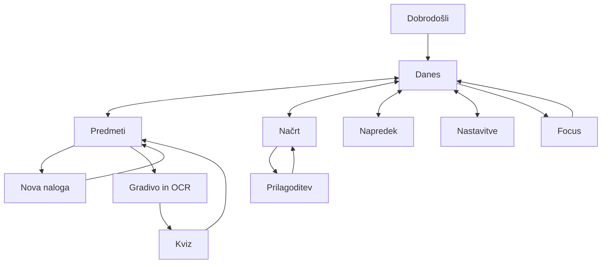

# Mockupi in navigacija

Prototip prikazuje predlagani uporabniški tok, ne končne Flutter aplikacije. Vsebina in statistika sta izmišljeni. Zunanje storitve, sistemska dovoljenja in senzorji niso povezani.

## Ogled

- [Pregled šestih ključnih zaslonov](mockupi/pregled.svg) je viden neposredno na GitHubu.
- [Interaktivni prototip](mockupi/index.html) odprite lokalno v brskalniku. Deluje brez namestitve paketov in brez interneta.

## Zasloni

| Zaslon | Namen in ključna dejanja |
| --- | --- |
| Dobrodošli | Prikaz možnosti prijave in prehod na lokalno uporabo. Prava prijava sledi pozneje. |
| Danes | Povzetek časa, današnje seje, zamujena obveznost in začetek učenja. |
| Predmeti | Seznam predmetov, obveznosti in dodajanje nove naloge. |
| Nova naloga | Predmet, vrsta, naslov, rok, trajanje, zahtevnost in prioriteta. |
| Načrt | Tedenski prikaz načrtovanih sej in prehod na predlog sprememb. |
| Prilagoditev | Primerjava starega in novega termina ter potrditev ali zavrnitev. |
| Focus | Pomodoro, začetek, premor, zaključek in prikaz načrtovanega Focus Mode. |
| Napredek | Primer tedenske statistike in razdelitve po predmetih. |
| Nastavitve | Razpoložljivost, obvestila, račun in Google Calendar. |
| Gradivo | Načrtovani tok kamere/OCR in popravka besedila. |
| Kviz | Vzorčni prikaz vprašanja z izbiro in povratno informacijo. |

## Navigacija

Spodnja navigacija povezuje Danes, Predmete, Načrt in Napredek. Nastavitve so dosegljive v glavi. Podzasloni imajo povezavo nazaj. Ta povezljivost je prikazana v prototipu, ne pomeni že delujočih integracij.

## Kaj lahko preverimo v prototipu

1. Izberemo lokalno uporabo na začetnem zaslonu.
2. Odpremo Predmete, dodamo veljavno vzorčno nalogo in jo vidimo na seznamu.
3. V Načrtu odpremo prilagoditev; zavrnitev ohrani termin, potrditev prikaže novi termin.
4. V Focus zaženemo, ustavimo in zaključimo predstavitveni časovnik.
5. Pregledamo Napredek in Nastavitve; shranjevanje razpoložljivosti je samo prikaz toka.
6. V Gradivu pogledamo vzorec OCR besedila in odpremo vzorčni kviz.

Podatki se ob osvežitvi ponastavijo. Prototip ne izračunava dejanskega načrta ali statistike, ne shranjuje na disk in ne pošilja gradiva v oblak. Prava validacija in trajno shranjevanje sta del razvoja aplikacije.
