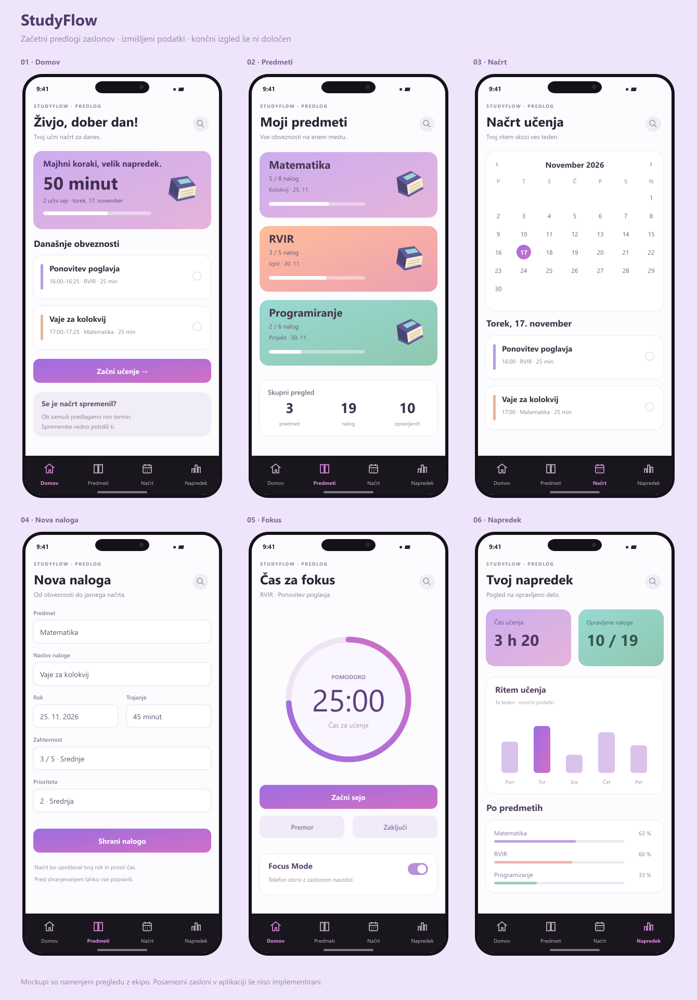

# Predlogi mockupov

Začetni predlog izgleda po poslani referenci: svetlo ozadje, pastelne kartice predmetov, vijolični poudarki in preprosta spodnja navigacija. Besedilo je slovensko, podatki izmišljeni. To niso posnetki delujoče aplikacije ali potrjen končni izgled.

[Vektorski pregled SVG](pregled.svg) je na voljo za nadaljnje urejanje.

## Posamezne slike

| Predlog zaslona | Kaj prikazuje |
| --- | --- |
| [Domov](slike/01-domov.svg) | Povzetek dneva, današnje naloge in začetek učenja. |
| [Predmeti](slike/02-predmeti.svg) | Pastelne kartice predmetov in pregled napredka. |
| [Načrt](slike/03-nacrt.svg) | Koledar in predvidene učne seje. |
| [Nova naloga](slike/04-nova-naloga.svg) | Predmet, naslov, rok, trajanje in prioriteta. |
| [Fokus](slike/05-fokus.svg) | Pomodoro in nastavitev Focus Mode. |
| [Napredek](slike/06-napredek.svg) | Vzorčni čas učenja, dokončane naloge in graf. |

[Galerijo](index.html) lahko odprete lokalno v brskalniku brez namestitve. Prikazuje slike; podatkov in funkcij aplikacije ne izvaja.

## Predvidena navigacija

**Domov ↔ Predmeti ↔ Načrt ↔ Napredek** so glavna področja spodnje navigacije. Iz Predmetov uporabnik odpre Novo nalogo, iz Domov ali Načrta pa Fokus. Podrobnosti nalog, prijavo, nastavitve, OCR in kvize oblikujemo v naslednjih korakih.

Predvideni tok prilagajanja: **Načrt → predlog novih terminov → potrditev ali zavrnitev → Načrt**. Ta tok še nima svojega mockupa in bo dodan pred implementacijo. Dovoljenja, prazna stanja in napake dopolnimo ob pregledu zaslonov z ekipo.
